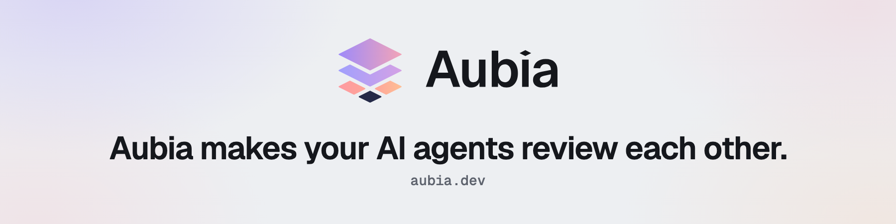

<picture>
  <source media="(prefers-color-scheme: dark)" srcset=".github/assets/aubia-github-header-en-dark.png">
  
</picture>

**English** | [Français](README.fr.md)

This public space welcomes your questions and ideas about Aubia, before and during the beta.

[Join the waitlist on aubia.dev](https://aubia.dev) | [Devlog](https://aubia.dev/en/blog) | [@aubia_dev on X](https://x.com/aubia_dev) | [Aubia on LinkedIn](https://www.linkedin.com/company/aubia-dev)

## The Aubia cockpit

Aubia is a desktop cockpit above Claude Code, Codex CLI and Mistral. One agent implements and a model from another family reviews: the two exchange the diff until convergence, and a lasting disagreement comes back to you. The [organization profile](https://github.com/aubia-dev) also covers Opinions to Executable Plan Mode, BYOK and the roadmap.

## Discussion categories

| You want to | Category |
|---|---|
| Ask a question or describe a problem | [Q&A](https://github.com/aubia-dev/community/discussions/categories/q-a) |
| Suggest a feature, an integration or a workflow | [Ideas](https://github.com/aubia-dev/community/discussions/categories/ideas) |
| Show what you built with Aubia | [Show and tell](https://github.com/aubia-dev/community/discussions/categories/show-and-tell) |
| Answer a poll | [Polls](https://github.com/aubia-dev/community/discussions/categories/polls) |
| Talk about anything else around Aubia | [General](https://github.com/aubia-dev/community/discussions/categories/general) |
| Follow announcements, releases and milestones | [Announcements](https://github.com/aubia-dev/community/discussions/categories/announcements) |

I answer new discussions within 24 to 48 hours on business days.

## Roadmap

The [aubia.dev roadmap](https://aubia.dev/en#roadmap) follows Aubia from beta 0.1 to 1.0. Each milestone reached is posted in Announcements.

## Contact

| Topic | Where |
|---|---|
| Product question | A Q&A discussion |
| Press, partnerships | `contact@aubia.dev` |
| Personal data, GDPR | `dpo@aubia.dev` |
| Security vulnerability | `contact@aubia.dev` |

## Code of conduct

Exchanges stay courteous and on topic. I moderate this space alone: a disrespectful or promotional message is removed without notice. The full rules are in [CODE_OF_CONDUCT.md](CODE_OF_CONDUCT.md), adapted from the Contributor Covenant 2.1.
